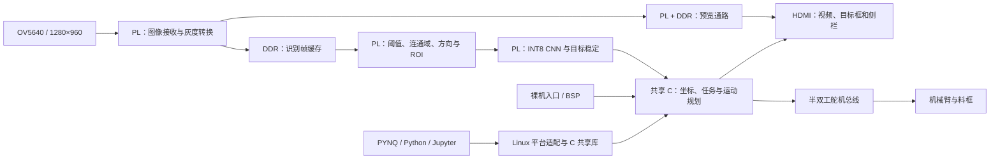

# ScrewSort · 螺影智拣

**基于 PYNQ-Z2 的 FPGA / ARM 协同紧固件识别、定位与机械臂分拣系统**

`Zynq-7020` · `RTL 硬件推理` · `INT8 CNN` · `裸机 C` · `PYNQ / Jupyter` · `18 类 / 12 目标`

[文档中心](report/README.md) · [完整复现指南](report/quickstart.md) · [操作手册](report/user_guide.md) · [系统架构](report/architecture.md) · [训练与权重部署](report/model_training.md) · [下载源码](https://github.com/gao-778/pynq-screw-sorter/releases/latest)

ScrewSort 将相机采集、目标定位、旋转归一化、CNN 分类、毫米坐标转换和机械臂分拣连成一个完整流程。OV5640 拍摄工作台上的紧固件，FPGA 找到目标并执行分类；ARM 处理交互、坐标与运动规划；HDMI 显示识别结果，摇杆和按键用于选择目标及启动分拣。

项目同时提供两种运行方式：**裸机 C 用于独立启动，PYNQ/Linux 用于 Python、Jupyter 调试与复现**。两者复用 C 业务核心、同一 PL 设计、模型与标定配置。PYNQ 入口负责组织硬件与数据流，CNN 卷积计算仍在 FPGA 中执行。

本仓库基于维护者已上板验收通过的文件整理；公开发布与文档更新保持运行核心不变。[验收来源](report/board_acceptance_20261103.json)与[实际复现记录](report/reproduction_review_20261103.json)分别保存。公开源码不含全部本地依赖及运行二进制，第一次复现请先看下面的材料选择表。

## 从这里开始

| 我想做什么 | 推荐入口 | 可以看到什么 |
|---|---|---|
| 先了解作品 | [功能与操作](report/user_guide.md) | 界面、摇杆、计数、单目标与自动分拣流程 |
| 从零梳理复现步骤 | [完整复现指南](report/quickstart.md) | 软件环境、依赖、离线检查、裸机与 PYNQ 两条路线 |
| 查接线与设备要求 | [硬件安装](report/hardware_setup.md) | 相机、HDMI、摇杆、舵机与平台配置 |
| 理解 FPGA 做了什么 | [系统架构](report/architecture.md) | PL/PS 分工、DDR、识别与显示、动作状态机 |
| 在 Notebook 中操作 | [PYNQ Notebook](board/notebooks/screwsort.ipynb) / [Python API](report/python_api.md) | 初始化、查询、任务请求与资源关闭 |
| 重新训练自己的类别 | [模型训练与部署](report/model_training.md) | 数据契约、量化、导出及硬件匹配 |
| 调整坐标或机械装置 | [标定说明](data/calibration/README.md) | 像素到毫米、方向变换与复标要求 |
| 遇到错误或缺文件 | [故障排查](report/troubleshooting.md) | HWH、依赖、ABI、相机、旧坐标与关闭问题 |
| 查所有文档和验证证据 | [文档中心](report/README.md) | 分主题索引、源码入口、检查记录 |

## 作品能做什么

| 模块 | 当前实现 |
|---|---|
| 目标识别 | 15 类螺丝 + 3 类螺母，最多同时发布 12 个目标 |
| 方向与定位 | 连通域候选、16 方向估计、旋转 ROI、OBB 中心及毫米坐标 |
| 视频与界面 | 相机预览、类别与位置显示、侧栏操作、统计、截图与状态反馈 |
| 单目标抓取 | 用摇杆选择一个可抓取目标，确认后按既定流程执行 |
| 指定类别抓取 | 选择当前场景中的一种螺丝，按空间顺序逐件抓取 |
| 自动分拣 | 最多四种可抓取类别按会话映射到四个料框，同类同框 |
| 视觉与动作协调 | 机械臂动作期间暂停分类；动作结束后重新确认场景与目标 |
| 统计与记录 | 查看累计统计、记录当前页面类别数量、保存画面及运行日志 |
| 调试与扩展 | Python 查询/控制、主机回归、硬件接口检查和可复用 Skill |

螺丝类别为 `M3_1…M3_5`、`M4_1…M4_5`、`M5_1…M5_5`；螺母为 `NUT_L`、`NUT_M`、`NUT_S`。**18 是类别数，12 是同时处理的目标上限，4 是自动分拣的料框/类别上限**，它们是不同概念。螺母参与识别、定位和计数，不进入机械臂抓取队列。

`_1…_5` 是本数据集中的规格标签，不能直接解释为毫米长度。内部模型索引也不等于屏幕编号，程序应按 [类别表](data/model/classes.json) 和 API 的类别名称传递目标。

## 一次识别与分拣如何完成

1. **采集场景。** 相机向 PL 输入图像，灰度识别帧和预览图像通过各自的数据通路进入 DDR。
2. **定位目标。** PL 统计灰度分布，产生自适应前景阈值，进行连通域、方向和几何量计算。
3. **完成分类。** 每个候选目标归一化为 64×64 灰度 ROI，由定点 CNN 联合几何特征输出类别。
4. **发布结果。** 目标匹配与跨帧稳定处理后，ARM 读取类别、位置和方向，转换为平台毫米坐标，界面更新结果。
5. **确认动作。** 用户选择目标、类别或自动分拣任务；程序使用新观测确认目标，并检查运动路径。
6. **抓取并继续。** 动作期间停止分类更新，预览通路继续工作；动作结束后重新观察场景，确认移除结果再选择下一目标。

该流程主要面向单层放置、能分离出轮廓的目标。物体粘连、遮挡、改变相机视野或更换机械装置时，需要单独评估分割和标定，不能只靠更换权重保证效果。

## 系统架构与软硬件分工



| 工作 | 执行位置 | 这样安排的原因 |
|---|---|---|
| 像素接收、灰度、阈值、目标几何与 ROI | PL / RTL | 流式数据量大，需要明确的像素与帧时序 |
| CNN 定点卷积和分类 | PL / RTL | 使用硬件乘加与片上数据存储，不在 ARM 上运行分类网络 |
| 图像存储与预览 | DDR + PL | 将大帧缓存与 CNN 的片上资源需求分开 |
| 标定变换、路径规划与串口事务 | PS / C | 状态分支多，便于维护、诊断和复用 |
| 实验调用、环境管理与日志查询 | PS / Python + Jupyter | 通过 PYNQ 管理 Overlay、连续内存和服务生命周期 |

这里的深度学习模型是**候选 ROI 分类器**。整张图的候选定位由前景检测与连通域逻辑完成，工程不是将通用 YOLO 权重直接加载到 FPGA。算法和接口细节见 [架构说明](report/architecture.md) 与 [接口契约](report/interface.md)。

## 模型、图像与资源

| 指标 | 当前配置 |
|---|---|
| 原始识别图像 | 1280×960 灰度帧 |
| CNN 输入 | 64×64 单通道旋转 ROI |
| 网络通道 | 1 → 32 → 96 → 256，三层 3×3 膨胀卷积 |
| 分类特征 | 深层 GAP 256 维 + 中层 GAP 96 维 + 3 项几何量，共 355 维 |
| 训练参数 | 255,912：255,510 个权重 + 402 个偏置；另有 3 个移位参数 |
| 部署数值 | INT8 权重、INT32 偏置，层间移位与整数参考对齐 |
| 显示输出 | 1280×720 HDMI；显示扫描、相机新帧和分类更新分别计量 |

三项几何特征描述投影长度及两端宽度，用于辅助区分规格；它们与旋转 ROI 必须来自同一帧、同一阈值。参数、类别和输入契约见 [模型清单](data/model/model_manifest.json)。

配套 PL 的既有布局布线报告如下，本轮文档更新沿用该硬件：

| 资源/时序 | 已用 / 可用 | 占用或结果 |
|---|---:|---:|
| LUT | 33,514 / 53,200 | 63.00% |
| FF | 21,991 / 106,400 | 20.67% |
| BRAM Tile | 134 / 140 | 95.71% |
| DSP | 63 / 220 | 28.64% |
| WNS / WHS | — | +0.015 ns / +0.050 ns |
| TNS / THS | — | 0 / 0 |

证据：[资源报告](build/reports/hardware/implementation/multiclass_utilization.rpt)、[时序报告](build/reports/hardware/implementation/multiclass_timing.rpt)。BRAM 占用较高，因此扩展网络需要重新评估存储与调度；不能仅因 LUT 或 DSP 有余量就直接换入任意大模型。

参考装置相机新画面约 11.67 fps；HDMI 60 Hz 是扫描时序，不是相机或 CNN 的处理频率。具体装置的帧率、识别时延和抓取成功率需要按实际设置记录，不能用离线分类结果代替整机指标。

## 复现前准备什么

| 所持材料 | 可以完成 | 还需要补充 |
|---|---|---|
| 仅 GitHub 源码 | 阅读实现、校验公开文件、运行独立发布工具测试 | 完整构建与上板需配套本地依赖和硬件产物 |
| 兼容的完整统一包 | 依赖导入、完整主机回归、目标构建与部署 | 工具链、板卡、外设、接线及当前装置标定 |
| 想重新训练 | 查看并运行训练/量化/导出程序 | 符合契约的照片、标注、固定划分及训练环境 |

公开包没有附 BSP/FSBL、部分运动学实现、相机配置 ROM、字库及包含它们的部署二进制；也没有完整原始训练照片。目前这些缺件没有公共下载入口。已持有合法完整包的使用者可以按哈希导入，详细范围见 [依赖与复现边界](report/reproducibility.md)。

| 硬件/软件 | 基线要求 |
|---|---|
| 板卡 | PYNQ-Z2，`xc7z020clg400-1` |
| 相机 | OV5640 DVP，参考模块 ATK-MC5640 V1.2 |
| 外设 | HDMI 显示器、模拟 X/Y 摇杆及 Z 键、SW1–SW4 |
| 机械臂 | 六个总线舵机，ID 1–6，半双工接口与独立电源 |
| FPGA / 裸机工具 | Vivado / Vitis 2026.1，匹配的 BSP、FSBL 与硬件 |
| PYNQ 软件 | 板卡对应 Linux 镜像；Python 3.10+、NumPy、gcc、PYNQ 与 Jupyter |

## 快速复现路线

### 1. 先做公开源码检查

```bash
git clone https://github.com/gao-778/pynq-screw-sorter.git
cd pynq-screw-sorter
python build/verify.py
python -m unittest discover -s sim/tests -p test_release_packaging.py -v
```

`source` 检查通过表示公开发行范围内的文件、模型与接口一致，并不表示被排除的依赖已存在。这两步不连接开发板、不操作机械臂。

### 2. 导入完整构建输入与同版硬件

```bash
# 指向兼容完整包中含 README.md、src/、build/ 的 screwsort 目录
python build/import_dependencies.py --release /path/to/full/screwsort
```

导入器逐项核验 126 项本地输入，但**不导入 BIT/HWH/XSA**。完整主机 API 回归也需要同版 `board/hardware/screwsort.hwh`；上板和 BOOT 构建还需要配套硬件产物。优先使用完整包本身作为工作副本，或按 [逐步指南](report/quickstart.md) 复制并核验同版硬件，再执行：

```bash
python build/verify.py
python sim/run_checks.py --cc /path/to/gcc
```

### 3A. 裸机独立启动

在 Windows 主机上使用匹配的 Vitis、BSP/FSBL 和 BIT：

```powershell
python build/build.py baremetal --vitis D:/AMD/2026.1/Vitis
python build/build.py boot --vitis D:/AMD/2026.1/Vitis
```

输出为 `build/output/baremetal/screwsort.elf` 和 `board/baremetal/boot.bin`。将后者复制到裸机专用 FAT32 SD 卡根目录，命名为 `BOOT.BIN`，断电插卡并选择 SD 启动。完整上电与操作说明见 [板上说明](board/README.md)。示例安装路径按本机位置调整。

### 3B. PYNQ / Jupyter 交互启动

先使用 PYNQ Linux 系统 SD 卡启动，保留系统自己的 BOOT。将补齐依赖和配套 BIT/HWH 的工程放到板上，例如 `/home/xilinx/screwsort`：

```bash
cd /home/xilinx/screwsort
python3 board/environment.py
python3 build/build.py linux
python3 board/run.py --seconds 30
```

默认只识别与显示。也可打开 [Notebook](board/notebooks/screwsort.ipynb)，或在同一工程根目录执行一个只观察结果的会话：

```python
import sys
import time
sys.path.insert(0, "src/python")
from screwsortmint import ScrewSortMint

app = ScrewSortMint()
try:
    app.prepare().initialize().start()
    for _ in range(3):
        time.sleep(1)
        print(app.status())
        print(app.results())
finally:
    app.close()
```

查询会话结束后对象已关闭。需要交互运动时，按 [Python API](report/python_api.md) 新建会话，核对当前装置的坐标与箱位后显式启用 `enable_motion()`，再请求 `pick()`、`auto_pick()` 或 `sort_all()`。方法返回表示请求提交，完成状态从 `status()` 与 `messages()` 判断。

两种入口分别启动；不要用裸机 `BOOT.BIN` 覆盖 PYNQ Linux 系统卡的 BOOT，也不要把 Windows 主机测试库当作 ARM 共享库部署。

### 4. 需要重新构建 FPGA 时

```powershell
python build/build.py hardware --vivado D:/AMD/2026.1/Vivado/bin/vivado.bat --output C:/fpga/screwsort_build
```

输出目录应位于项目外、尚不存在，建议短英文路径。脚本使用 RTL、XDC 与 BD Tcl 生成工程/IP，执行综合实现并导出同次 XSA 的 BIT/HWH。`--prepare-only` 只完成工程生成；它不产生已完成实现的位流。详细说明见 [构建与发布](build/README.md)。

## 仓库里有哪些文件

```text
src/       共享 C 核心、平台适配、Python 接口、FPGA RTL、训练程序
sim/       API、状态机、串口、运动、坐标与 RTL 检查
build/     构建脚本、依赖清单、发布清单与既有实现报告
board/     Notebook、运行/证据采集入口、Overlay 契约
data/      部署模型、类别、标定与训练输入说明
skill/     七项可复用的 FPGA / PYNQ 工程方法
report/    文档中心、复现、操作、架构、接口、排错与验证记录
```

`board/hardware/` 和 `board/baremetal/` 中的运行产物随完整本地包提供，公开源码仓库不会因为路径出现在文档中就自动包含这些二进制。

## 已完成哪些核验

2026-11-03 的[复现核验](report/reproduction_review_20261103.json)从干净 Git 源码开始，完成了依赖导入、匹配 HWH 后的完整主机回归与目标编译：

| 检查 | 记录 |
|---|---|
| 发布工具回归 | 21 项通过 |
| Python / C API | 18 项通过 |
| 共享业务状态机 | Linux、裸机各 23 项通过 |
| 串口 / 运动恢复 / 坐标 | 25 组协议、10 组联合运动、32 例坐标检查通过 |
| Linux ARM 共享库 | 实际交叉编译通过 |
| 裸机 ELF 与 BOOT | 实际构建、打包与分区校验通过 |
| 运行内容对应 | 原复现基线 134 项公开文件一致、6 项排除文件哈希匹配；本轮仅更新说明文档 |

维护者确认的上板结果、电脑端测试、既有 FPGA 实现报告分别记录，避免混淆验证范围。文档更新不改变这些运行内容，也不重新声称测得分类准确率或机械臂成功率。完整证据索引见 [验证说明](report/validation_scope.md)。

## 可复用的 FPGA / PYNQ Skill

项目提炼了软硬件划分、视觉与动作门控、舵机总线诊断、证据整理、裸机到 PYNQ 适配、Overlay 契约核验、DMA 生命周期管理七项方法。每项包含适用范围与操作步骤；板卡地址、模型和机械坐标仍由具体工程配置。

查看 [Skill 总览](skill/README.md) 与 [本项目案例](skill/examples/screw_sort_case.md)。这些方法可以帮助组织调试与复现，不代替新硬件的接口检查和实测。

## 许可、版本与问题反馈

原创代码、文档和部署模型采用 [MIT](LICENSE)。第三方文件保留各自许可，公开排除范围见 [第三方说明](report/licenses/third_party.md)。完整本地包包含某文件不代表它可以随公开仓库再分发。

- [最新源码与校验文件](https://github.com/gao-778/pynq-screw-sorter/releases/latest)
- [变更记录](CHANGELOG.md)
- [提交问题](https://github.com/gao-778/pynq-screw-sorter/issues)：请附版本、运行方式、环境、复现步骤与相关日志。
- 遇到缺件或启动问题，先查看 [故障排查](report/troubleshooting.md)；更换相机或机械臂位置后先复标。
