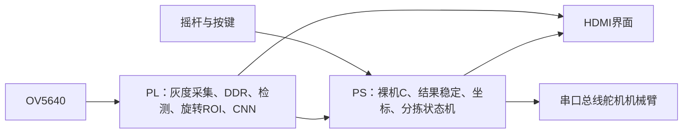

# PYNQ-Z2 螺丝识别与机械臂分拣工作台

在 PYNQ-Z2 上，用 FPGA 完成图像处理和量化 CNN 推理，用 Cortex-A9 裸机 C 程序组织采集、界面、坐标转换与机械臂控制。

本目录整理自 `BUILD_MC18_UI_MINT_ARM_BUS_FIX_20261101`。最新修复针对舵机位置回读超时和恢复策略，原模型、标定与运动参数保持一致。**本工程使用 PYNQ-Z2 板卡，但不运行 PYNQ Linux、Python Notebook 或 Overlay API。**

## 功能与范围

- 15 类螺丝＋3 类螺母，最多同时显示 12 个目标；螺母目前只识别、定位和统计。
- OV5640 采集 1280×960 灰度输入，DDR 图像访问、前景检测、旋转 ROI 和 CNN 位于 PL。
- CNN 输入 64×64，通道 1→32→96→256，255,912 个可训练参数；模型与硬件有固定量化及寄存器契约。
- HDMI 界面显示目标、坐标与统计，支持摇杆和四按键、单目标／单类夹取及最多四类自动分拣。
- 原装置相机新画面约 11.67 fps，HDMI 扫描 60 Hz；两者都不等同于 CNN 的识别频率。



详细说明：[架构](docs/ARCHITECTURE.md) · [硬件与接线](docs/HARDWARE.md) · [模型](docs/MODEL.md) · [验证范围](docs/VALIDATION.md) · [第三方来源](docs/THIRD_PARTY.md)。

## 目录

| 目录 | 内容 |
|---|---|
| `software/` | 本版 PS 应用、串口协议、运动执行状态机、界面与坐标处理 |
| `hardware/` | 自研 RTL、约束、BD 配置及可迁移重建入口；厂商生成实现由 Vivado 产生 |
| `model/` | 本版 18 类部署权重、类别顺序、量化和参考计算契约 |
| `training/` | 最终模型的训练源文件、关联证据和复现限制 |
| `calibration/` | 原工作台标定示例与坐标核对工具 |
| `scripts/` | 本地依赖导入、编译、打包、测试与发布检查 |
| `tests/` | UART 时序、位置回读恢复与联合运动回归 |
| `config/` | 基线哈希、编译配置和本地依赖清单 |
| `external/`、`build/` | 仅在本机生成，Git 忽略，不随公开源码上传 |

## 为什么有本地依赖

完整旧交付包包含厂商 IP 实现、预编译 BSP、Windows 字体生成的 ROM，以及来源许可尚未补齐的 IK 派生文件和相机配置表。它们没有被统一改成 MIT，也没有放进公共 Git 树。已经拥有原完整工程、且有权本地使用这些材料的开发者，可以导入后复建同一版。

**目前仅 clone 公共仓库，还不足以直接生成完整 BOOT。** 缺少哪些依赖、来源和后续替换方向见 [第三方说明](docs/THIRD_PARTY.md)。原始数据集也未公开；训练源码的公开不代表完整数据训练可以一键重现。

## 在已有完整交付包的电脑上复建

推荐短路径，Windows、Python 3.10+、Vivado/Vitis 2026.1；主机回归另需 GCC。以下路径请替换成自己的安装位置。

```powershell
# 1. 把你自己的原完整 ARM_BUS_FIX 工程导入 external/；文件会逐一验哈希
python scripts/import_local_dependencies.py --release C:/fpga/private_release

# 2. 编译本版 Cortex-A9 应用，不接触板卡
python scripts/build_software.py --vitis-root C:/AMD/2026.1/Vitis --verify-baseline

# 3. 使用本地原版 bitstream/FSBL 生成 BOOT，并检查全部分区
python scripts/package_boot.py --vitis-root C:/AMD/2026.1/Vitis

# 4. 在主机模拟舵机反馈，检查协议、恢复与动作指令
python scripts/run_host_tests.py
```

生成结果在 `build/firmware/` 和 `build/boot/<时间>/BOOT.BIN`。脚本不会写 SD 卡、加载 FPGA 或控制机械臂。新生成 BOOT 的时间戳与调试路径可不同于原始发布文件，不承诺文件哈希相同。

硬件独立重建见 `hardware/README.md` 及 `python scripts/rebuild_hardware.py --help`。这里的软件打包默认使用经过验证的原硬件；自行更换 bitstream 后，应重新核对 XSA、BSP、地址映射和模型 ABI。

## 运行与复用

原完整版本的 BOOT 放入 FAT32 SD 卡根目录，使用 SD 启动。接线及操作见 [硬件说明](docs/HARDWARE.md)。本仓库不附可公开再分发的原 BOOT 下载附件。

机械臂连杆尺寸、舵机方向、工作台标定、垫高、抓取高度和投放点都是原装置参数。复用到另一台机械臂前，先做离线坐标与可达性验证；不能把 0～1000 的协议范围当成机械防碰撞范围。启动时不会自动执行夹取，动作由用户明确触发。

本版已完成主机回归和固件构建检查，**2026-11-01 回读修复版尚未进行实物上板验证**。历史时序及模型指标的含义和边界见 [验证说明](docs/VALIDATION.md)。

## 许可与贡献

项目原创代码与本项目生成的部署模型采用 [MIT](LICENSE)；第三方例外及未分发的依赖见 [LICENSE_SCOPE.md](LICENSE_SCOPE.md) 和 [THIRD_PARTY.md](docs/THIRD_PARTY.md)。训练原始照片没有随本仓库授权发布。

反馈问题时请提供版本标记、操作步骤、实际现象和经过脱敏的日志片段。提交前运行本地检查，避免附带 `external/`、数据集、旧运行日志或生成的二进制。GitHub 首次上传步骤见 [PUBLISH.md](docs/PUBLISH.md)。
