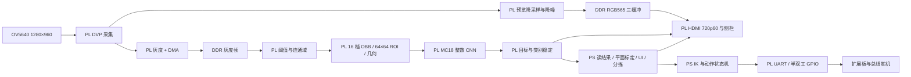

# 系统架构与数据流

当前版本在 PYNQ-Z2 的 **PS 运行 standalone 裸机 C，PL 运行自定义 RTL 图像处理与整数 CNN**。PC 上的 Python 用于训练、参数导出、参考计算和构建辅助；板上推理不依赖 Python、Linux 或 Jupyter。这里使用了 PYNQ-Z2 板卡，但并未交付 PYNQ Linux Overlay 驱动。

## 软硬件分工

| 部分 | 负责的工作 | 主要源码 |
|---|---|---|
| 相机与预览 PL | DVP 采集、预览降采样与降噪、DDR 三缓冲、HDMI 时序及叠加显示 | [hardware](../hardware/) 中的 `frame_snapshot.v`、`ddr_preview.v`、`preview_area_average.v`、`preview_shadow_chroma.v`、`hdmi_recognition_display.v` |
| 识别 PL | 灰度帧读取、自适应阈值、连通域候选、旋转方向、ROI、几何特征、CNN、跨帧稳定 | `recognition_core_obb.v`、`ddr_gray_reader.v`、`component_labeler.v`、`obb_orientation.v`、`roi_sampler_obb.v`、`cnn_classifier.v`、`temporal_object_filter.v` |
| PS C | SCCB 相机配置、DMA 调度、权重上传、读结果、标定坐标转换、UI 事务、SD 保存 | [software/main.c](../software/main.c)、[recognition_app.h](../software/recognition_app.h)、[platform_coordinates.h](../software/platform_coordinates.h)、[dashboard_app.h](../software/dashboard_app.h) |
| PS C 机械臂 | 候选复核、任务管理、逆运动学、完整路径规划、舵机反馈和有限恢复 | [auto_pick_app.h](../software/auto_pick_app.h)、[arm_motion.c](../software/arm_motion.c)、[arm_bus.c](../software/arm_bus.c)；`arm_kinematics.c` 需从有权使用的原包本地导入，见[来源说明](THIRD_PARTY.md) |
| 摇杆/按钮 | PL XADC 采样、按键输入；PS 校准、迟滞、去抖与菜单控制 | `joystick_inputs.v`、[joystick_app.h](../software/joystick_app.h) |

## 一轮识别如何执行

1. PS 初始化相机、检查硬件 ID，将内嵌的 `shape_model.h` 上传到 PL 参数存储器并提交。权重不是在 ARM 上执行卷积。
2. 相机采集得到 1280×960 灰度帧，DMA 写入 DDR。单帧 1,228,800 字节；两灰度帧槽基址为 `0x10000000` 和 `0x10200000`，槽跨度 2 MiB。
3. PL 在同一帧上计算自适应前景阈值，以连通域形成候选，再估计 OBB 方向。方向采用 180° 内 16 档，即 11.25° 一档；这是离散方向归一化，不是任意精度旋转。
4. PL 按硬件一致的旋转和遮罩规则生成 64×64 灰度 ROI，同时提取长度、两端宽度三项几何特征。它们一起输入 MC18 模型。
5. PL 输出 18 类分数与几何结果，并进行跨帧目标/类别稳定。可报告的目标容量是 12，与“18 个类别”是不同概念。
6. PS 对当前实测 OBB 中心与方向应用平面变换，生成毫米坐标。显示框可以滤波；机械臂观察值使用当前帧实测几何及真实采集时间，不把旧平滑框直接当作最新位置。

这是“传统前景候选检测 + OBB 归一化 + CNN 分类”的系统，不是端到端 YOLO 检测器。黑色背景、物体分离和可见轮廓仍对连通域定位有影响；增加 CNN 参数不能解决全部遮挡或粘连检测问题。

## 显示、识别和运动的速率

HDMI 输出扫描是 1280×720、60 Hz。相机预览覆盖完整输入视野，先降至 320×240，再放大到左侧 960×720，整体旋转 180°；右侧 320 像素宽为 UI。屏幕像素数、相机采集像素数和 CNN ROI 大小不能互换。

当前相机使用约 11.67 fps 配置；此数值是新画面更新率，并非 CNN 识别频率。预览使用 DDR 三缓冲与换帧握手，图像降噪仅在预览支路，不能据此宣称模型输入也经过同样降噪。最新总线修复版未重新实测相机速率。

[workstation_config.h](../software/workstation_config.h) 的识别启动周期为 200 ms，即目标调度上限 5 Hz。实际频率受整帧处理、目标数量、CNN 延迟、保存与机械臂任务影响，不保证 12 个目标时稳定达到 5 Hz。

夹取期间暂停分类调度并隐藏框，PL 视频预览继续运行。自动任务在下一次夹取前后台复核新图像；暂态结果不会在 UI 中反复闪烁。

## UI 与分拣行为

侧栏包含累计统计、记录数量、保存画面、目标选择、坐标显示、夹取目标、自动分拣七项。常态结果显示目标标号、型号与坐标，累计统计打开后替换相应结果区域。单类模式红框突出所选类型；自动分拣最多四种颜色区分四个分拣槽，颜色不永久绑定型号。

当前机械臂只允许抓取前 15 个螺丝类别；大中小螺母参与识别、定位、计数和邻近障碍检查，不进入螺丝抓取控制。

- 单目标：投放到左上盒。
- 单类别：投放到右上盒。
- 自动多类：按类别分配四个盒子，同类同盒；从左到右执行，每次抓取前重新确认位置。

自动任务需要明确启动，不会看到下一批物体就自行开始。正常重复抓取需新鲜目标、连续确认以及抓后移除核验；最终命令仍受 750 ms 新鲜度限制。总线读回恢复只能重读位置，不能重放运动指令，也不能把超时冒充到位。

## 固定接口与移植点

| 接口 | 当前地址/标识 |
|---|---|
| 识别控制 | AXI `0x42000000`，硬件拓扑 ID `0x4D433138` |
| 权重写入 | 相对识别基址 `0x70` 流式端口 |
| 偏置 / 激活移位 | 相对基址 `0xE800` / `0xEF00` |
| UI | AXI `0x43000000` |
| 灰度 DMA / 屏幕 DMA | `0x40400000` / `0x40410000` |
| 屏幕抓图缓冲 | DDR `0x11400000`；1280×720×4 字节 |
| 舵机 UART / 方向 GPIO | `0x43C00000` / `0x41210000` |

硬件 ID、类别编码高位、参数数量、目标容量与 C 头文件必须配套。不能仅替换权重文件把 MC18 模型装进旧 15 类位流。DDR 地址也不是通用 API；更改 BD 地址映射后须同步检查软件与内存布局。

有效 PS 源码在 [software](../software/)。硬件导出内容在 [hardware](../hardware/)。历史工程保留的 `base/main.c` 一类文件不是当前启动程序入口；运行链由 FSBL、配套位流和当前应用 ELF 组成。
