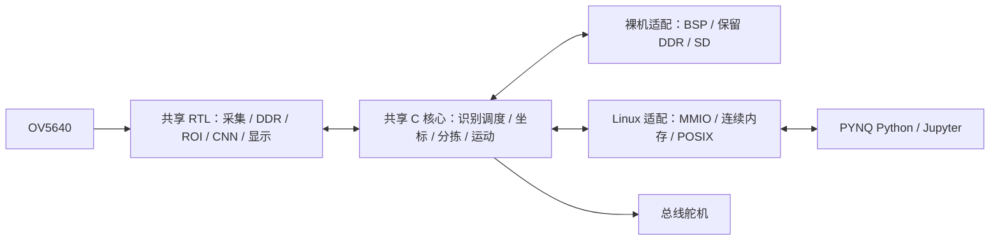

# 架构

src/common 是唯一业务源码所有者。两种目标均编译 build/project.json 的 shared_sources，分别链接 platform/baremetal 或 platform/linux。Python 通过同一 C ABI 服务应用；裸机 main 直接调用同一初始化、有限工作量 service 和关闭接口。

硬件只有一套动态地址 RTL 与 BD，导出一对 BIT/HWH 和同次 XSA。MC18 参数、类别、标定和料框配置均由共享核心引用。平台差异限于缓冲区所有权、虚拟地址访问、时间、文件和控制台。
