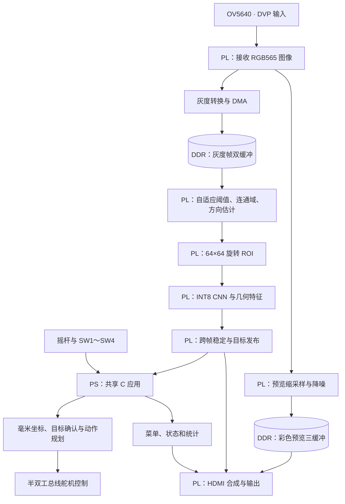
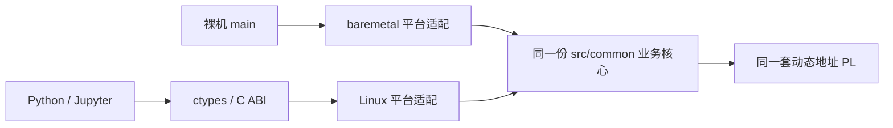

# 系统架构与数据流

ScrewSort 在一块 PYNQ-Z2 上完成相机采集、紧固件识别、HDMI 交互和机械臂分拣。**PL 负责图像与 CNN 运算，PS 负责应用调度、坐标与运动控制。** 裸机和 PYNQ/Linux 编译同一份 C 业务核心，选择各自的平台适配层；Python/Jupyter 提供交互和资源管理入口。

这份文档解释系统为什么这样划分。可执行部署步骤见 [快速开始](quickstart.md)，具体操作见 [工作台使用说明](user_guide.md)，寄存器地址与 ABI 见 [接口契约](interface.md)。

## 1. 整体组成

| 部分 | 主要职责 | 为什么这样划分 |
|---|---|---|
| FPGA / PL | 相机接收、灰度与彩色数据通路、阈值、连通域、旋转裁剪、CNN、框线与显示 | 对大量像素重复处理，适合流水线与定点运算 |
| ARM / PS 共享 C | 模型与相机初始化、识别调度、坐标变换、目标确认、分拣和舵机状态机 | 需要事件调度、浮点几何、外设事务与错误处理 |
| Python / Jupyter | Overlay 加载、连续内存管理、命令/查询、实验记录和服务生命周期 | 便于交互调试和复用硬件接口 |
| DDR | 保存完整灰度帧、彩色预览帧和截图 | 降低完整图像缓存对片上 BRAM 的占用 |
| BRAM / DSP | CNN 参数和工作缓存、局部图像缓冲、定点乘加等 | 为计算核提供片上访问和运算资源 |

机械臂由同一块板的 PS 调度，经 PL 提供的 UART/GPIO 接口访问，不依赖额外树莓派在线分类。训练在电脑端完成；部署时 FPGA 只做推理。

## 2. 从一帧图像到最多十二个目标

当前原生图像为 **1280×960**，网络处理的每颗零件 ROI 为 **64×64 灰度图**。前者决定整个平台的空间采样密度，后者决定网络每次分类的输入规模。

1. **采集并锁定灰度帧。** DMA 将一帧写入 DDR，识别链使用该帧及其采集时间。处理过程中不换成另一帧的部分像素。
2. **计算自适应阈值。** 按步长 8、偏移 4 取直方图样本，以 P50/P90 与限制范围生成本帧阈值。阈值统计与后续前景提取保持一致。
3. **连通域定位。** 对前景进行八连通域处理，形成候选框和面积等信息。该方案依赖能分开的前景，不等价于能处理任意粘连、堆叠或遮挡的通用检测器。
4. **方向和几何量。** 在半周内的 16 个候选方向中确定长轴，并提取投影长度、两端宽度。
5. **旋转 ROI。** 从同一灰度帧按定点坐标采样，得到统一朝向的 64×64 输入；超出图像或目标范围的位置按契约填零。
6. **CNN 分类。** 灰度特征与三个几何特征共同参与 18 类输出，随后进行跨帧匹配与稳定处理。
7. **一致发布。** 目标类别、框、方向和采集时间以同一场景版本交给 PS 与显示端，最大容量为 12。

详细的阈值公式、采样舍入、几何量缩放和类别顺序保存在 [模型契约](../data/model/model_manifest.json)。它们是训练端与 FPGA 推理端必须一致的条件。仅替换一个不同架构的权重文件不能改变这些硬件运算。

## 3. CNN 采用什么结构

MC18 为项目定制的轻量定点分类网络，CNN 不直接从整图回归所有目标框。整图定位由前景与连通域模块完成，CNN 对裁剪出的每颗零件分类。

| 阶段 | 配置与输出 |
|---|---|
| 输入 | 64×64×1 灰度 ROI |
| 第一层卷积 | 3×3，通道 1→32，膨胀率 2，随后池化 |
| 第二层卷积 | 3×3，通道 32→96，膨胀率 2；池化前提取中层 GAP |
| 第三层卷积 | 3×3，通道 96→256，膨胀率 2，提取深层 GAP |
| 特征融合 | 深层 256 维＋中层 96 维＋几何量 3 维，共 355 维 |
| 输出 | 18 类：15 类螺丝＋3 类螺母 |

模型含 **255,510 个权重、402 个偏置，共 255,912 个可训练参数**，另有 3 个移位参数。权重采用 INT8，偏置采用 INT32；RTL 复用乘加资源完成多层计算。三项几何量提供原图中的投影长度及头尾宽度信息，补充 ROI 缩放后不易保留的尺寸差异。

参数以 `model.bin`、NPZ、HEX 与 C 头文件等多种形式提供，它们表达的是同一组部署数据，不是多套独立模型。`build/verify.py` 校验其内容、CRC、类别与接口一致性。训练、量化与导出说明见 [训练教程](../src/training/README.md) 和 [模型文件说明](../data/model/README.md)。

## 4. 为什么识别和预览分成两条 DDR 通路

识别需要原始灰度细节，预览需要连续彩色画面，因此使用不同缓冲和发布节奏。

| 通路 | 有效图像数据 | 缓冲用途 |
|---|---|---|
| 灰度识别 | 1280×960、每像素 1 字节，一帧 1,228,800 字节 | 双缓冲使采集与识别分开使用完整帧 |
| 彩色预览 | 320×240 RGB565，一帧 153,600 字节 | 三缓冲协调相机写入、已发布帧及显示读取 |
| HDMI 截图 | 1280×720 合成画面，DMA 容器每像素 4 字节 | 截取视频、框线与侧栏后的完整显示结果 |

缓冲区的实际预留容量包含地址布局和对齐，不等同于上述单帧有效数据量。裸机分别预留灰度 4 MiB、预览 768 KiB、截图 3,686,400 字节；PYNQ 动态分配相同容量。准确尺寸与地址上限见 [overlay_contract.json](../board/overlay_contract.json)。

PL 图像主设备经 AXI 访问 PS DDR。CNN 参数及中间计算仍受片上资源和当前加速核结构约束；使用 DDR 图像缓存不代表能够直接装入任意大的神经网络。

## 5. 三种频率要分开看

| 频率 | 表示什么 |
|---|---|
| HDMI 扫描刷新 | 显示器接收到的扫描时序，当前输出为 1280×720、60 Hz |
| 相机/预览新帧 | 新的相机图像产生、完成发布并被显示端接受的速度 |
| 识别完成频率 | 完成一份目标检测、ROI 分类及结果发布的速度 |

屏幕连续扫描可以重复使用上一张预览图，因此 HDMI 60 Hz 不能说明相机有 60 fps。当前调度配置为 200 ms 识别启动周期，但识别耗时随目标数量和状态而变化。资源/性能结论应关联具体硬件报告和实际运行日志，见 [验证说明](validation_scope.md)。

## 6. 裸机和 PYNQ 如何共用一个应用

`src/common` 是共享业务逻辑的源码入口。两个目标都使用 [build/project.json](../build/project.json) 中的 `shared_sources`，分别链接 `src/platform/baremetal` 或 `src/platform/linux`。

| 项目 | 裸机 | PYNQ/Linux |
|---|---|---|
| 启动方式 | FSBL＋BIT＋ELF 打包为 BOOT，从 SD 启动 | Linux 先启动，由 Python 加载 BIT/HWH |
| C 应用入口 | `main()` 直接调用初始化与循环服务 | Python 后台线程调用共享库中的同一 C ABI |
| DDR 所有权 | 保留的物理地址空间 | `pynq.allocate` 管理连续缓冲区，绑定 CPU 指针与设备地址 |
| 外设访问 | BSP、寄存器和裸机缓存操作 | MMIO 映射、缓存回调和 Linux 平台函数 |
| 文件输出 | SD FAT 文件系统 | 应用输出目录 |
| 退出 | 停止应用、排空设备，随后按裸机流程重启 | 排空并释放会话资源，不重启 Linux |

共享核心以 `sl_initialize()`、`sl_service()`、`sl_shutdown()` 组织生命周期。`sl_service()` 每次推进有限工作，运动关键期优先服务串口，再处理识别、界面和截图，避免一次长文件操作拖住舵机反馈。

PYNQ 层负责 `prepare → initialize → start → stop/close`。`prepare()` 核对同名 BIT/HWH、七个 MMIO 窗口、MC18 模型 ID、12 目标容量及 ABI；分配灰度、预览、截图三块独立缓冲，完成地址绑定后才允许生产者运行。关闭时等待运动服务和 AXI/DMA 事务排空，再释放内存。相关方法见 [Python API](python_api.md)。

两种运行方式是分别启动的选择，不在同一时刻共同占有硬件。Windows 上用于主机测试的库也不能直接当作板上 ARM 的共享库。

## 7. 视觉结果如何进入机械臂控制

PS 将 OBB 中心像素变换为平台毫米坐标，并变换主轴方向。之后结合原机底座位置、拾取高度和独立的命令补偿生成运动目标。显示坐标与机械臂命令副本分开，局部抓取补偿不改变屏幕坐标或分类结果。

单目标流程锁定操作时选中的目标并刷新坐标。自动批次则在每次动作之前用四个新帧确认下一目标，要求位置、类别、方向一致，并以坐标中值减弱抖动。运动过程中暂停分类；动作完成后重新采集，并用两个新帧检查原位置是否为空、该类别数量是否减少，然后才继续。

自动分拣按启动时数量限定本批动作，最多四个类别分配到四个料框。目标刷新失败、路径不可达或舵机反馈错误不会被隐式当成成功。更详细的状态、按键和投放规则见 [操作手册](user_guide.md)。

## 8. 在源码中从哪里开始读

| 想理解或修改的部分 | 入口 |
|---|---|
| C 初始化、主循环与对外 ABI | [app.c](../src/common/app.c)、[screwsort.h](../src/common/screwsort.h) |
| 相机采集、识别调度和故障诊断 | [recognition_app.h](../src/common/recognition_app.h)、[sensor_exposure.h](../src/common/sensor_exposure.h) |
| PL 顶层识别、CNN 与跨帧稳定 | [recognition_core_obb.v](../src/fpga/rtl/recognition_core_obb.v)、[cnn_classifier.v](../src/fpga/rtl/cnn_classifier.v)、[temporal_object_filter.v](../src/fpga/rtl/temporal_object_filter.v) |
| 菜单、统计、截图与摇杆 | [dashboard_app.h](../src/common/dashboard_app.h)、[joystick_app.h](../src/common/joystick_app.h) |
| 单目标与自动分拣 | [fusion_pick_app.h](../src/common/fusion_pick_app.h)、[auto_pick_app.h](../src/common/auto_pick_app.h) |
| 视觉与动作隔离 | [recognition_motion_gate.h](../src/common/recognition_motion_gate.h) |
| 机械臂动作、反馈和协议事务 | [arm_motion.c](../src/common/arm_motion.c)、[arm_bus.c](../src/common/arm_bus.c) |
| Python 会话、内存和命令封装 | [app.py](../src/python/screwsortmint/app.py) |
| 两种目标的构建和接口配置 | [build/project.json](../build/project.json)、[接口契约](interface.md) |

本仓库基于维护者已确认上板通过的版本整理。代码一致性、构建复现和实机验收来源分别记录在 [验收来源](board_acceptance_20261103.json) 与 [复现核验](reproduction_review_20261103.json)。运行算法保持不变，不将文档扩写计作新的算法或硬件性能结果。
