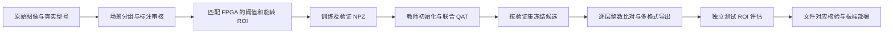

# 数据、训练、量化与模型部署

[返回项目首页](../README.md) · [文档中心](README.md) · [部署复现](reproducibility.md) · [模型契约](../data/model/model_manifest.json)

本页说明当前 **MC18：15 类螺丝＋3 类螺母** 的训练链，以及训练产物怎样对应 FPGA。训练在电脑端完成；板上的 PL 执行旋转 ROI 与整数 CNN，PS 负责模型加载、调度、坐标及运动。

**运行现有模型不需要重新训练。** 仓库已提供部署模型和整数参考；原始照片、完整标注、场景扫描清单及全部准备数据没有公开。下面的训练步骤要求使用者先准备符合接口的数据，并不表示克隆仓库就能从零重现原训练结果。

## 1. 先区分三项工作

| 目标 | 所需材料 | 推荐入口 |
|---|---|---|
| 使用当前识别与分拣系统 | 部署模型、同版硬件、平台依赖与装置标定 | [复现指南](quickstart.md) |
| 核对模型文件是否一致 | 仓库中的 BIN、NPZ、HEX、C 头及契约 | `python build/verify.py` |
| 用自己的照片重训 | 图像真值、固定分组、ROI/几何量、训练环境及评估集 | 本页第 3～9 节 |

本工程的 CNN 是**单个候选目标分类器**。整帧目标由自适应阈值和连通域逻辑提出，再提取方向、ROI 和几何量后分类；这里没有直接训练 YOLO 整帧检测网络。OBB 标注用于表达物体位置与方向、核对候选和裁剪，不能把任意 YOLO 权重直接换成当前 `model.bin`。



## 2. 当前模型与类别不能随意改序

当前结构由 [model_contract.py](../src/training/mc18/model_contract.py) 和 [architecture_contract.json](../data/model/architecture_contract.json) 定义：

| 部分 | 配置 |
|---|---|
| 输入 | `1×64×64` 灰度 ROI，另输入 3 项几何量 |
| 卷积 | 三层 `3×3`，通道 `1→32→96→256`；膨胀率与 padding 均为 2 |
| 下采样 | 前两层卷积后各进行一次 `2×2` 最大池化 |
| 中层分支 | 第二层池化前的 96 通道全局平均池化 |
| 深层分支 | 第三层 256 通道全局平均池化 |
| 分类输入 | `256＋96＋3＝355` 维，连接 18 类输出 |
| 参数 | 255,510 个权重＋402 个偏置＝255,912 个可训练参数；另有 3 个移位配置 |
| 部署数值 | INT8 权重、INT32 偏置，卷积右移配置为 `[6,6,6]` |

类别文件 [classes.json](../data/model/classes.json) 保存的是模型内部索引顺序，**不等于屏幕上从小到大排列的编号**：

| 内部索引 | 型号 | 屏幕编号 | 内部索引 | 型号 | 屏幕编号 |
|---:|---|---:|---:|---|---:|
| 0 | M3_5 | 5 | 9 | M3_2 | 2 |
| 1 | M3_4 | 4 | 10 | M3_3 | 3 |
| 2 | M3_1 | 1 | 11 | M4_2 | 7 |
| 3 | M4_5 | 10 | 12 | M4_4 | 9 |
| 4 | M4_3 | 8 | 13 | M5_2 | 12 |
| 5 | M4_1 | 6 | 14 | M5_3 | 13 |
| 6 | M5_5 | 15 | 15 | NUT_L | 16 |
| 7 | M5_4 | 14 | 16 | NUT_M | 17 |
| 8 | M5_1 | 11 | 17 | NUT_S | 18 |

`M3_1` 等是本项目的实物类别名，不应把后缀自动解释为毫米长度。螺母的 L/M/S 表示已确认的大/中/小三种实物；旧目录 B 对应 L，M、S 分别对应，具体螺纹规格没有由这些标签给出。记录见 [label_mapping_status.json](../src/training/mc18/label_mapping_status.json)。螺母参与识别、定位与统计，当前机械臂策略不抓取螺母。

## 3. 图像采集与标注准备

### 3.1 保留原始相机图像和采集条件

当前前处理按 `1280×960` 原始相机图像设计。保留原图，不要使用带 UI、框线或文字的 HDMI 截图代替训练输入。采集时建议记录型号、光照条件、相机取景/曝光档、拍摄批次、实物编号和场景编号。

同一型号需要覆盖位置、方向、亮暗和高光变化；不同型号应在相同光照域中都有样本，避免模型把某种背景或亮度当作类别提示。近乎相同的连拍、同一摆法仅换曝光的图像应视为相关场景，不能随机拆到训练集与测试集两边。

本定位方法依赖可分开的前景区域。接触、严重遮挡、出画面、手进入画面或强反射造成的碎片，应单独记录并审核；不能因为它位于某个型号文件夹，就把全部连通域都当成正确零件。

### 3.2 OBB 格式与训练实际输入

OBB 可保存为每个目标一行的归一化四角点格式：

```text
class_id x1 y1 x2 y2 x3 y3 x4 y4
```

这里 `class_id` 使用上一节的内部索引；`x` 除以 1280，`y` 除以 960。四角沿框周边连续排列，不能交叉成蝴蝶结。当前螺母准备脚本按局部 `左上→右上→右下→左下` 四点，经量化方向旋回原图后输出；对应文件位于训练输出的 `labels_obb/`。

**当前训练入口不直接读取这份 YOLO OBB 文本。** 它实际读取已生成的 ROI/几何量 NPZ。原流水线先从整帧提取候选，再依据已确认的单类场景标签、分组和质量规则生成数据；OBB 文本是位置审核产物之一。若从外部标注工具导入，应实现并核对“标注目标→原图候选→RTL 一致 ROI”的转换，而不是只把 TXT 放入目录就启动训练。

混合型号图像必须逐个目标提供真实类别；不能给一张混合图所有零件继承同一个文件夹名。当前历史单类目录准备器不会自动解决这个问题。无论人工标注还是自动候选，都应查看覆盖图，剔除重复框、合并框、碎片、出界框及错误类别，并保留剔除原因。

## 4. 与 FPGA 一致的前处理

参考实现位于 [prepare_dataset.py](../src/training/mc18/reproducibility_inputs/legacy/prepare_dataset.py)、[auto_obb_reference.py](../src/training/mc18/reproducibility_inputs/legacy/auto_obb_reference.py) 和 [shape_obb_reference.py](../src/training/mc18/reproducibility_inputs/legacy/shape_obb_reference.py)。

1. **灰度。** 已是灰度的图像直接使用；彩色输入按工程的整数灰度转换读取。不要自行换成另一个加权公式或先做未经验证的直方图均衡。
2. **整帧阈值。** 以 `gray[4::8,4::8]` 统计 P50/P90，使用 `T = clamp(P90 + max(8, 3×(P90−P50)), 40, 220)`。候选、方向、几何量和掩膜使用同一帧的阈值。
3. **候选与方向。** 连通域生成包含边界的 AABB；方向从半周内 16 个候选角选取，间隔 11.25°，三角值采用 Q8 整数表。
4. **旋转裁剪。** 采样方形边长为 `ceil(sqrt(w²+h²))`。按整数坐标旋转映射到原图，越出 AABB 或图像的采样点填零；不能直接用通用图片编辑软件旋转、双线性缩放来代替。
5. **像素编码。** 前景保留 `raw_gray >> 1`，其余填零，因此 ROI 数值范围是 0～127。网络内部再除以 128；不要在输入 NPZ 中重复归一化。
6. **几何量。** 依次为 `min(127, 投影长度>>1)`、`min(127, 2×较宽端宽度)`、`min(127, 2×较窄端宽度)`。这是前景投影得到的量，不是直接把 OBB 标注宽高代入。

训练数据保留 `images32` 作为历史/配对核对字段，当前 MC18 使用 `images64`。准备器断言 `images64[:,::2,::2]` 与配对的 32×32 ROI 一致，用于约束整数采样过程。

光度增强在整帧上执行，再重新计算阈值、重检测并与原目标匹配。只对最终 64×64 裁剪做亮度变化，不能覆盖阈值变化导致候选形状改变的影响。现有增强包含增益、gamma、偏置、阴影、高光、噪声，以及相邻方向/小位移；匹配失败的目标有单独统计，不应悄悄计入分类正确率。

## 5. 数据布局与固定划分

配置在 [settings.py](../src/training/mc18/settings.py)：

| 配置 | 默认值 | 含义 |
|---|---|---|
| `SCREWSORT_DATASET` | `data/training/` | 原始数据、历史螺丝划分与准备结果的根目录 |
| `SCREWSORT_TRAIN_OUTPUT` | `build/output/training/` | 本轮合并数据、训练日志和候选模型输出 |
| 教师参数 | `src/training/mc18/reproducibility_inputs/teacher.npz` | 当前扩宽与蒸馏初始化所用的历史十五类参数 |

环境变量可在 PowerShell 中这样设置，路径应换成真实数据位置：

```powershell
$env:SCREWSORT_DATASET = 'D:/screwsort-data'
$env:SCREWSORT_TRAIN_OUTPUT = 'D:/screwsort-training/run01'
```

历史数据合并入口 [prepare_data.py](../src/training/mc18/prepare_data.py) 需要：

```text
SCREWSORT_DATASET/
├── inputs/fixed_split_manifest.json
└── output/
    ├── dataset_trainval.npz
    ├── dataset_test.npz              # 冻结后测试阶段使用
    └── dataset_report_test.json      # 最终覆盖率报告使用

src/training/mc18/nut_scan.json       # 本地补齐，公开包不附
```

`nut_scan.json` 的记录引用真实图像，并包含 `image`、`source`、`lighting`、`class_name`、`sha256`、`frame_rejected`、`threshold`、`diagnostics` 和 `objects` 等字段；目标含 `aabb_xyxy`、`area`、`length`、`width`、`angle_index`、`bounds`、`foreign_pixels`。这里的图像摘要按前处理读取后的**灰度字节**计算，不应误填原 BMP 文件的摘要。完整字段读取方式以准备脚本为准。

原螺丝划分由 `fixed_split_manifest.json` 继承。新增螺母按同类前景布局相似度聚成场景组，再按类别与光照域分层，采用约 70%/15%/15% 的训练/验证/测试分配；组数量必须足够，脚本不支持用一两个相同摆法凑齐三个集合。几何筛选中位数只从训练集计算，隔离帧进入 `quarantine`。

每个训练 NPZ 至少要与当前脚本的字段约定一致：

| 字段 | 形状/内容 | 用途 |
|---|---|---|
| `images64` | `N×1×64×64`，0～127 的整数灰度 | 当前 CNN 输入 |
| `geometry` | `N×3`，0～127 | 三项几何量 |
| `labels` | `N`，内部索引 0～17 | 类别真值 |
| `splits` | `train` / `val`；测试文件仅 `test` | 固定划分 |
| `family` | `clean` / `pose` / `photo` | 原图、姿态和光度增强族 |
| `lighting`、`condition` | 光照域与具体扰动名称 | 分域评价、加权及保护规则 |
| `ids`、`scene_groups` | 原目标身份与场景组 | 追踪来源、检查重复与泄漏 |
| `images32`、`thresholds` | 配对小 ROI 与帧阈值 | 现有准备器/报告链使用 |

当前训练器还专门检查 `OLD`、`YEW`、`WAY`、`H_W_WAY` 的旧螺丝表现，并要求各类有 `clean/pose/photo` 训练样本。**它是本项目数据流程，不是任意类别/任意域名称的通用训练器。** 换自己的数据组织时，应同步审查域名、分组和保护规则，不能随意改标签来绕过检查。

## 6. 准备数据与启动训练

在独立工作副本操作，保留当前已部署模型。以下命令均从项目根目录执行。

训练环境依赖见 [requirements.txt](../src/training/mc18/requirements.txt)。其中包含记录环境的 CUDA 版 PyTorch；应根据机器和 CUDA 环境安装匹配的软件，不能假定该记录可在所有电脑上直接安装。CPU 可以用 `--device cpu`，GPU 示例使用 `--device cuda`；现有训练器会把数据张量放到所选设备，显存需求不能只按模型参数量估算。

### 路径 A：已有完整 MC18 准备数据

把经过审核的 `dataset_trainval.npz` 放入训练输出根目录，同时保留完整的分组、来源和预处理记录。教师模型在源码指定位置。运行：

```bash
python src/training/mc18/prepare_reproduction_inputs.py
python src/training/mc18/train_model.py --device cuda --epochs 24 --batch 64
```

第一条**只检查教师文件与训练 NPZ 存在**，不会下载照片、生成标注或自动准备数据。测试评估仍需要第 8 节列出的元数据，不能只交两个 NPZ 就认为整条报告链齐全。

### 路径 B：沿用历史螺丝＋新增螺母的合并流程

先补齐第 5 节的历史 NPZ、固定清单、实际图像和本地 `nut_scan.json`，再执行：

```bash
python src/training/mc18/prepare_data.py --initialize
python src/training/mc18/prepare_reproduction_inputs.py
python src/training/mc18/train_model.py --device cuda --epochs 24 --batch 64
```

`--initialize` 先分组、筛选、生成 OBB 审核文件，**同一次命令随后也生成训练/验证数据**。已有审核完的初始化记录、只需重建训练 ROI 时，可运行不带参数的 `prepare_data.py`。此阶段不带 `--test`。

训练会从教师整数参数扩宽初始化，拟合分类头并进行联合量化感知训练（QAT）；按类别、光照域和增强族加权，使用旧类保护门槛及螺母验证门槛选模。默认 `--epochs 24` 是上限，早停可能提前结束，并不保证任意新数据最终都有可导出的合格模型。

查看训练输出的 `training/progress.json`、`baseline_validation.json`、`sample_weights.json` 和 `selection_report.json`。正常完成时会生成 `selected_candidate.pt`、`selected_candidate.npz`，并将选择状态写为 `VALIDATION_FROZEN`。`NO_GUARD_PASS` 表示没有合格候选，应查数据、分类混淆和验证门槛，不应把该状态手改为通过。

`freeze_validated_progress.py` 是恢复历史已完成联合训练进度的工具，包含历史命令/轮次记录；`finalize_training_reports.py` 也含历史实验叙述。它们不应作为每次新训练的无条件步骤。普通训练正常结束已有冻结候选；若使用恢复工具，需核对进度、选定检查点和记录是否确属本轮。`--head-only` 只训练分类头，不满足当前正式导出器要求的联合 QAT 及实际整数卷积权重变化条件。

## 7. 量化和导出产物

导出器会写入工作副本的 `data/model/`。确认验证集已经选定候选、保留旧模型后运行：

```bash
python src/training/mc18/export_model.py --publish
```

这里的 `--publish` 是**导出到本地模型目录**，不会上传 GitHub。它要求映射已确认、`selection_report.json` 为冻结状态、候选来自 `joint_qat`，且导出的整数卷积权重确有训练更新。导出时按类别、光照域和增强族选取验证样本，逐层比较 QAT 结果与独立 NumPy int64 参考，包括池化、GAP、拼接特征和 logits。

| 文件 | 内容与用途 |
|---|---|
| `model.bin` | FNET-v1；24 字节头含标识、版本、三种参数数量和 CRC，后面是小端 `uint32` 参数容器 |
| `quantized_model.npz` | 权重、偏置、移位数组以及类别/结构，供 Python 整数核对 |
| `weights.hex` | 每行一个 8 位权重的十六进制表示，负数按补码编码 |
| `biases.hex`、`shifts.hex` | 每行一个 32 位数值的十六进制表示 |
| `shape_model.h` | 与 BIN/HEX 一致的 C 内嵌参数，由共享应用加载至硬件 |
| `best_qat.pt` | 选定 PyTorch 检查点；不是直接交给 Verilog 解析的文件 |
| `model_manifest.json`、`classes.json` | 结构、预处理、量化、参数摘要和类别顺序 |
| `export_verification.json` | 逐层整数比对和多格式一致性结果 |
| `training_report.json`、`weight_change_report.json` | 选模依据、实际整数权重变化 |
| `export_marker.json`、`artifact_hashes.json` | 冻结模型标记与对应文件摘要 |

参数的紧凑数值容量为 `255510＋402×4＋3×4＝257130` 字节，但 FNET 把每个参数放在一个 32 位容器中，因此当前 BIN 为 `24＋255915×4＝1023684` 字节。不要把 BIN 文件大小直接当成纯 INT8 权重容量或板上全部 BRAM 用量。

## 8. 冻结之后再测试

沿用合并数据路径时，导出完成后再生成测试 ROI：

```bash
python src/training/mc18/prepare_data.py --test
python src/training/mc18/export_model.py --evaluate --device cuda --batch 64
```

测试数据生成会检查冻结模型标记。已有准备数据时，也需提供匹配的 `dataset_test.npz`、`nut_annotations.json`、`frame_augmentations_test.json`，以及历史 `SCREWSORT_DATASET/output/dataset_report_test.json`，因为最终评估还统计筛选及增强匹配覆盖率。

评估输出包括 `final_test_report.json`、`test_predictions.npz`，以及模型目录中的 `test_report.json` 和 `test_coverage_report.json`。脚本发现已有最终测试结果时会拒绝重复评估，避免不断看测试集调参。新的实验使用新的输出目录并保持独立测试方案。

报告至少分别给出原始 ROI、姿态扰动、光度扰动的准确率、宏平均 F1、混淆矩阵、每类召回与光照域结果。还应保留候选拒绝、增强后匹配失败和样本量，不能只保留最好的一行数字。

当前导出评估衡量的是**筛选后的 ROI 分类**，不等于全帧目标检出率，也不等于机械臂夹取成功率。历史十五类螺丝测试分组在此前开发中使用过，应作为内部回归看待；新拍、独立批次的数据才适合检验新的场景泛化。参数更多或完成 QAT 都不能自动保证任意光照下的准确率。

## 9. 与共享软件、FPGA 和发布包对应

导出器将新 C 头写到 `data/model/shape_model.h`；实际共享应用使用 [src/common/shape_model.h](../src/common/shape_model.h)。在独立工作副本中核对后同步这份头文件，同时保持 BIN/NPZ/HEX 和类别、结构契约一致，再重建需要部署的平台。

同结构换权重也要重新验证：

1. 检查 `export_verification.json` 为通过，所有输出来自同一个冻结候选。
2. 同步共享 C 参数；核对 18 类内部顺序、355 维特征、ROI、权重/偏置数量与 MC18 硬件 ID。
3. 按 [构建说明](../build/README.md) 重新编译共享库或裸机 ELF/BOOT，并更新该轮真实产物的对应记录。
4. 先运行 `python build/verify.py --no-manifest`，核对 FNET CRC、NPZ、HEX、C 数值、软件模型摘要与硬件契约；该选项只跳过旧发行文件清单，不跳过模型及构建对应检查。根据错误定位真实不一致；`board/overlay_contract.json`、`report/correspondence.json` 和构建记录中的模型关联也要来源于新一轮实际产物，不能沿用旧模型摘要和旧测试结论。
5. 按需要运行 [主机/RTL 回归](../sim/README.md)，再在自己的装置上验证误检、漏检、分类稳定与坐标。确认识别后才进入抓取验证。
6. 完成内容与产物核验后，使用 `python build/package.py --refresh` 更新本地发布文件清单，再运行 `python build/verify.py` 并打包。刷新清单只更新文件摘要，不能替代模型正确性或板端验证。

**不能仅换一个更大权重文件扩容。** 改通道数、层数、输入尺寸、类别数或特征布局，会涉及 `model_contract.py`、FPGA 分类核的计算/存储布局、寄存器和参数加载、软件类别及模型契约。需要重新核对资源、时序、整数参考、仿真及硬件导出；较早十五类位流也不兼容当前十八类高位类别 ABI。

## 10. 建议保留的训练交付材料

| 阶段 | 保留材料 |
|---|---|
| 采集 | 原图、实物类别表、拍摄条件、场景/批次编号 |
| 标注 | 每目标真值、OBB/覆盖图、剔除清单及原因、标注版本 |
| 划分与前处理 | 固定分组清单、前处理契约版本、ROI NPZ、各域/类别数量、摘要 |
| 训练 | 软件环境、完整命令、种子、进度、验证指标与选定检查点 |
| 导出 | BIN/NPZ/HEX/C 头、逐层整数比对、模型契约与文件摘要 |
| 测试与上板 | 独立测试真值、混淆矩阵、候选覆盖率、实际运行日志及对应 BOOT/BIT/模型摘要 |

这样可以分别回答“照片和类别是否正确”“训练/推理前处理是否一致”“模型为何被选中”“参数有没有转错”“板上运行的是哪一版”，也能在以后补拍光照或扩大模型时继续比较。
