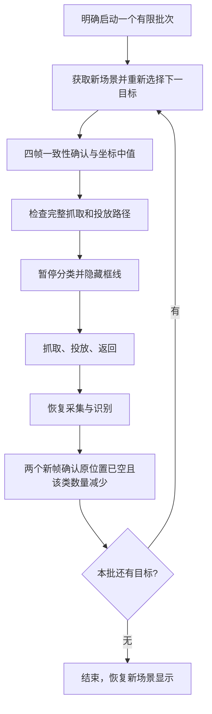

# 工作台操作与分拣流程

这份说明对应当前公开仓库的 **18 类、最多 12 个同时检测目标**版本。它适用于配套裸机程序和 PYNQ/Linux 共享应用；两种入口使用相同识别与分拣核心。首次接线和启动请先看 [硬件安装](hardware_setup.md) 与 [复现教程](reproducibility.md)。

## 1. 一次完整运行会发生什么

1. 启动后，程序检查模型、硬件接口、相机与图像有效性；摇杆保持松开，让程序完成中位校准。
2. 摄像头持续提供画面，FPGA 检测目标、提取旋转 ROI 并进行 CNN 分类。
3. 右侧显示当前数量、型号与毫米坐标；左侧叠加目标框。识别结果可用于手动计数、单目标抓取或分拣。
4. 操作者明确选择目标或启动一批任务。机械臂动作开始后，分类暂停，目标框隐藏，彩色预览继续。
5. 动作结束后重新采集、识别并核对场景；自动任务确认上一目标已离开，再选择下一目标。
6. 一批任务完成后停止等待，不会因为又放入零件就自行启动另一批。

**仅开启菜单不会立即抓取。** 单目标或批次的开始由摇杆 Z 键确认；PYNQ 会话还需先显式调用 `enable_motion()`。

## 2. 类别、编号和目标标号

| 屏幕编号 | 型号显示 | Python 类别名 | 当前处理方式 |
|---|---|---|---|
| 1～5 | M31～M35 | `M3_1`～`M3_5` | 识别、定位、计数、抓取 |
| 6～10 | M41～M45 | `M4_1`～`M4_5` | 识别、定位、计数、抓取 |
| 11～15 | M51～M55 | `M5_1`～`M5_5` | 识别、定位、计数、抓取 |
| 16～18 | N_L、N_M、N_S | `NUT_L`、`NUT_M`、`NUT_S` | 识别、定位、计数，不进入抓取队列 |

类别名中的 `_1`～`_5` 是本项目数据集的规格编号，不应直接理解成长度为 1～5 mm。螺母 L/M/S 表示已采集的三种实物尺寸，不额外推断其公称螺纹规格。

画面中的 **A～L 是本帧目标标号**，用于将一个框与结果表中的一行对应；它不是型号，也不是长期固定的物体序列号。内部 `class_id` 的顺序见 [classes.json](../data/model/classes.json)，与屏幕的 1～18 顺序不同。调用 Python API 时优先传 `M3_1` 这样的完整类别名。

## 3. 画面各区域的作用

| 区域 | 显示内容 | 如何使用 |
|---|---|---|
| 左侧识别画面 | 相机预览、旋转框、目标标号、可切换坐标轴 | 检查零件姿态和所选目标 |
| 右侧顶部 | 视频帧率、当前识别数量 | 查看显示是否持续更新及当前场景容量 |
| 状态卡片 | 正在识别、等待新坐标、夹取中、动作阶段、完成或错误信息 | 判断当前是在识别、规划还是执行 |
| 七个侧栏选项 | 统计、记录、截图、选择、坐标、单类夹取、自动分拣 | SW1/SW3 移动，SW2 确认 |
| 右侧下部 | 默认显示目标、型号、X/Y；也可切为累计统计或分类列表 | 对照目标位置、计数和本批分拣进度 |

界面中的“视频帧率”来自预览新画面被显示端接受的计数；它不是 CNN 每秒完成的识别次数，也不是 HDMI 的 60 Hz 扫描频率。当前识别调度周期配置为 200 ms，但完成频率还取决于目标数量、图像处理和状态确认，不能把它直接写为恒定 5 Hz。

## 4. 摇杆与按键

| 输入 | 当前功能 |
|---|---|
| SW1 | 侧栏光标向上，首尾循环 |
| SW3 | 侧栏光标向下，首尾循环 |
| SW2 | 执行当前侧栏选项 |
| 摇杆 X/Y | 目标选择开启时选择空间邻近目标；分类列表开启时用于列表与顺序导航 |
| 摇杆 Z | 目标选择状态下请求抓取选中螺丝；分类/自动面板中启动批次，批次运行中再次按下请求停止 |
| SW4 | 自动面板内停止任务；其他运动状态下请求停止；空闲时关闭会话 |

空闲 SW4 关闭会话后，裸机程序按设计重新启动；PYNQ 会话停止但不会重启 Linux。板载 BTN0～BTN3 不承担这些功能。SW4 是软件停止请求，不能代替独立的电源急停。

开机时不要按住摇杆：当前程序需要 64 个稳定的新 ADC 样本确定中位。方向输入包含迟滞、持续确认和长按重复，长拨可以连续移动；这是选择目标的离散导航，不是控制机械臂随摇杆连续运动。

## 5. 七个侧栏选项

| 选项 | 按 SW2 后的行为 |
|---|---|
| **累计统计** | 显示/隐藏累计统计表。打开时替换默认识别结果表；关闭后恢复目标型号与坐标表 |
| **记录数量** | 将当前一份有效场景中各类别数量累加一次，并自动打开累计统计显示 |
| **保存画面** | 保存当前 HDMI 合成画面，包括预览、框线和侧栏；保存中显示进度状态 |
| **目标选择** | 开启/关闭摇杆单目标选择，供单颗抓取使用 |
| **坐标显示** | 显示/隐藏画面中的坐标轴；不修改标定数据或机械臂坐标变换 |
| **夹取目标** | 打开/关闭“选一种型号”的分类列表；运动中该项显示为“停止运动” |
| **自动分拣** | 打开/关闭全部可抓取螺丝的分拣面板，按类别分配最多四个料框 |

### 记录数量不是自动去重计数

“当前数量”随场景变化；“累计数量”只有显式记录时才增加。若同一批零件不动，连续成功按两次“记录数量”，会被记录两次。这适合人工逐批记录，不是自动去重的库存台账。

当前累计统计由 PL 中 18 个 32 位计数器保存，达到上限时饱和。开关统计界面不会清空计数；它也不是掉电保存的数据库。记录期间若识别正在更新、运动导致结果隐藏或场景无效，程序会提示等待，不应把该次点击理解成记录成功。成功提示为“记录完成 +…颗 / 总计…”。

### 保存画面存在哪里

裸机版生成 `SCREENS/LCD00001.BMP` 等文件；PYNQ 版经平台层保存到会话的输出目录（默认 `board/output/`）下。程序先写 `.TMP`，完成后再改名为 `.BMP`。它保存的是 **1280×720 HDMI 合成画面**，不等同于训练所需的 1280×960 原始相机帧。机械臂忙时会要求稍后保存。

## 6. 单颗、单类和全部分拣有什么区别

| 模式 | 开始方式 | 目标范围 | 投放规则 |
|---|---|---|---|
| 单颗抓取 | 开启“目标选择”，X/Y 选中目标，按 Z | 当前选中的一颗螺丝 | BIN1，左上料框 |
| 单类抓取 | 打开“夹取目标”，选择型号，按 Z | 启动场景中该型号的螺丝 | BIN2，右上料框 |
| 全部自动分拣 | 打开“自动分拣”，按 Z | 启动场景中所有可抓取螺丝，最多四种类别 | 每种类别分配一个料框，同类同框 |

### 单颗抓取

1. 用 SW1/SW3 移到“目标选择”，按 SW2 开启。
2. 用摇杆 X/Y 选择一颗螺丝，同时核对框和右侧目标坐标。
3. 按 Z，状态先显示更新目标位置。程序锁定所选目标身份，再要求坐标足够新；这时不要换目标。
4. 位置、长轴和路径检查通过后执行抓取，并投放到 BIN1。

单目标待刷新超时配置为 2 s，使用目标的采集年龄门槛为 750 ms。位置无效、长轴不明确、零件过近或完整抓放路径不可达时会拒绝动作；“能识别到”不等于“机械臂一定可达”。

### 选定一种型号连续抓取

1. 打开“夹取目标”。列表列出当前场景中的型号和数量；螺母标为 `VIEW`，不能启动抓取。
2. 摇杆向上/下选择类别；向左选择从左到右，向右选择从上到下。
3. 选中类别的框使用红色，其他类别保持默认蓝色；切换类别时高亮随之切换。
4. 按 Z 开始该批。每次动作前都会重新识别该类下一颗的位置，全部投放到 BIN2。
5. 批次结束后，再按 Z 才开始另一批。运行中按 Z 或 SW4 可以请求停止。

### 自动分拣最多四种类别

1. 放置已分离、可抓取的螺丝，准备好四个料框，打开“自动分拣”。
2. HDMI 操作默认按从左到右排序；此面板中的摇杆方向不切换排序方式。Python `sort_all(order=...)` 接口另支持两种排序参数，详见 [API](python_api.md)。
3. 启动前使用最多四种框线颜色作类别视觉区分。颜色不是永久型号编号，也不应单凭颜色判断料框位置。
4. 按 Z 后，程序根据启动场景建立有限数量的任务。遇到尚未分配的类别，依次分配 BIN1～BIN4；列表显示实际 BIN 映射。
5. 同一应用运行会话内保留类别与料框的映射，关闭/重开面板不会重新洗牌。四个位置已分配后出现新类别，会停止并提示；清空料框、重新开始应用会话后再建立新映射。

一批运行时不要主动加入新类别或不断补料。本实现是“视频持续运行、每次动作前重识别”的有限批次分拣，不是无限自动补单的输送带系统。

## 7. 为什么动作中看不到分类框

机械臂和夹爪进入视野会改变前景。动作中暂停分类并隐藏框线，可以避免把机械臂误当作目标，或把动作前的位置直接用于下一次抓取。彩色视频通路仍继续运行。

自动批次采用以下确认流程：

四帧确认要求不同的新采集结果、至少 300 ms 的时间跨度，以及位置和长轴方向的一致性。随后使用四帧 X/Y 中间两个值的均值构成目标坐标，减少一帧跳动的影响。下一目标等待及移除确认各有 4 s 超时门槛，过期或不一致的结果不会直接触发机械臂。

批次中间的新识别在后台完成，界面显示动作/确认状态，不反复闪出下一颗的框。程序分别记录“动作完成”和“视觉确认目标离开”；后者仍不是夹持力或成功入盒的传感器证明，演示与成功率统计需要结合实物观察。

## 8. 坐标、料框与可达范围

显示坐标单位是毫米，原点来自平台标记，+X 向屏幕右、+Y 向上。目标坐标是旋转框几何中心经平面单应变换得到的位置。改变相机位置、视野或工作平面后，应重新完成 [平台标定](../data/calibration/README.md)。

当前原机料框配置如下，均是相对平台原点的毫米坐标：

| 料框 | 方位 | X | Y | 投放高度 Z |
|---|---|---:|---:|---:|
| BIN1 | 左上 | −130 | +100 | 60 |
| BIN2 | 右上 | +130 | +100 | 60 |
| BIN3 | 左下 | −130 | −170 | 60 |
| BIN4 | 右下 | +130 | −170 | 60 |

原机底座相对平台原点为 `(0,−150)` mm，底座垫高 100 mm，平台拾取高度配置为 3 mm。抓取末端保持 −90°；投放按路径检查允许使用非垂直姿态。当前代码还含原机 X/Y 命令补偿和下半区局部 Y 补偿，它们只修正机械臂指令，不应作为其他装置的标定常数直接照搬。

目标粗筛在机械臂坐标中检查 `|X|≤100 mm`、`80≤Y≤230 mm`、平面半径不超过 240 mm，随后仍要检查逆运动学和完整抓放路径。它不是平台坐标中的矩形可达承诺，也不是整个机械臂的精确工作空间图。

实际配置来源为 [visual_pick.h](../src/common/visual_pick.h)、[sort_bins.h](../src/common/sort_bins.h) 和 [运动学接口](../src/common/arm_kinematics.h)。迁移装置时先重新标定并核对料框，而不是只改屏幕显示坐标。

## 9. 演示与问题反馈

建议先演示识别和坐标，再演示“记录数量”、一颗抓取、单类抓取，最后演示不超过四类的分拣。如此可以区分视觉、交互和机械执行的问题，避免把一次完整失败都归到 CNN。

出现错误时保留屏幕状态和运行日志。裸机看 SD 卡 `RUNLOG.TXT`；PYNQ 可保存 `status()`、`results()`、`metrics()`、`messages()` 以及输出目录。反馈时同时提供源码版本、运行方式、实际型号和动作模式；仅提供模型预测不能用来核算分类准确率。

具体排查见 [故障排查](troubleshooting.md)。验证口径见 [验证与复现](validation_scope.md)。

---

实现依据：[菜单与按键](../src/common/joystick_app.h)、[显示和统计](../src/common/dashboard_app.h)、[单目标流程](../src/common/fusion_pick_app.h)、[自动批次状态机](../src/common/auto_pick_app.h)、[识别暂停与恢复](../src/common/recognition_motion_gate.h)、[类别映射](../src/common/recognition_classes.h)。
